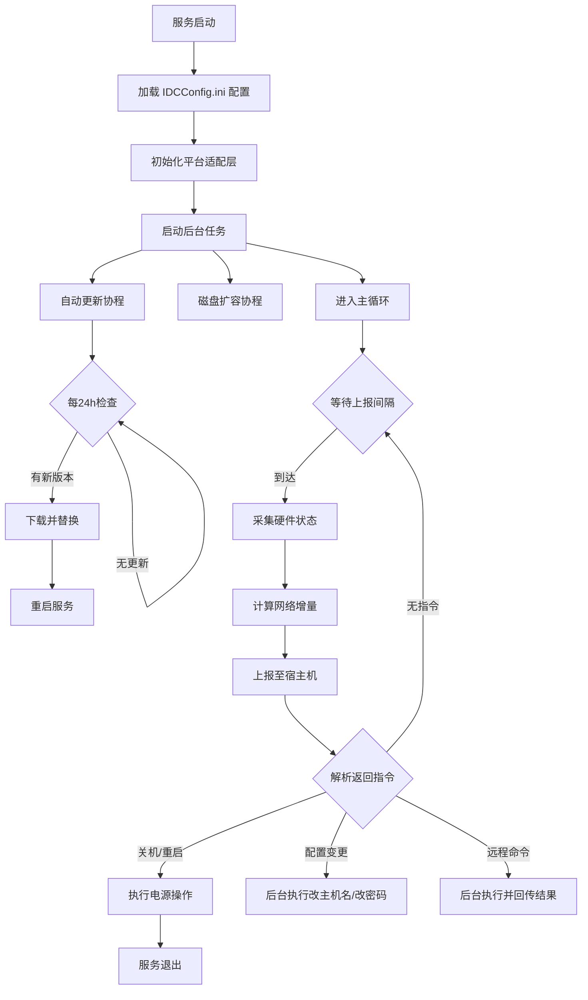

# CloudInit

OpenIDC 虚拟机初始化与状态上报服务。部署在虚拟机内部，负责定时采集硬件状态上报至宿主机，并接收宿主机下发的控制指令（关机/重启/改密/改主机名），同时支持磁盘自动扩容和服务自动更新。

服务使用 Go 编写，单一静态二进制，无需运行时依赖。

## 功能特性

- **状态上报** - 定时采集 CPU/内存/磁盘/GPU/网络 等硬件状态，上报至宿主机
- **指令执行** - 接收宿主机下发的关机、重启、改密码、改主机名等控制指令
- **命令下发** - 接收宿主机下发的远程命令，异步执行并回传结果
- **磁盘扩容** - 启动时自动检测并扩容根分区（支持 ext4/xfs/btrfs/APFS/NTFS）
- **自动更新** - 后台守护协程每24小时检查 GitHub Release，自动下载更新
- **多平台支持** - 通过平台抽象层适配 Linux / Windows / macOS
- **配置覆盖** - 支持 `IDCConfig.ini` 文件覆盖默认运行参数

## 执行流程



## 项目结构

```
CloudInit/
├── main.go                  # 服务入口（主循环、上报、指令处理、信号）
├── go.mod / go.sum          # Go 模块依赖
├── IDCConfig.ini            # 运行配置文件（可选，覆盖默认参数）
├── MASAIO.cmd               # Windows 激活脚本
│
├── apppath/                 # 运行目录 / 可执行文件路径
├── logger/                  # 日志（控制台 + 按天轮转文件）
├── config/                  # 配置加载器（解析 IDCConfig.ini）
│
├── core/                    # 核心管理模块
│   ├── manage.go            # 虚拟机配置管理（改主机名/改密码，非阻塞）
│   ├── disk.go              # 磁盘扩容（非阻塞）
│   ├── power.go             # 电源控制（关机/重启）
│   ├── cmdexecutor.go       # 远程命令执行与结果回传
│   └── autoupdate.go        # 自动更新（后台守护协程）
│
├── platform/                # 平台抽象层
│   ├── platform.go          # 接口定义 + hosts 处理 + 命令执行封装
│   ├── linux.go             # Linux 实现
│   ├── windows.go           # Windows 实现（含 VMTools 检测、系统激活）
│   └── darwin.go            # macOS 实现
│
├── nic/                     # 网卡管理模块
│   ├── ncmanage.go          # 网卡扫描与管理
│   ├── ncconfig.go          # 网卡配置数据模型
│   └── gateway_*.go         # 各平台默认网关探测
│
├── status/                  # 状态采集模块
│   ├── vmstatus.go          # 硬件状态采集器
│   ├── hwstatus.go          # 硬件状态数据模型
│   ├── vmpowers.go          # 电源状态枚举
│   └── gpu.go               # GPU 负载采集（nvidia-smi）
│
├── remotedesk/              # ToDesk 远程桌面管理
│   ├── todesk.go            # 启动 ToDesk、解析设备代码/临时密码
│   └── window_*.go          # 主窗口隐藏（Windows）
│
├── PasswdDump/              # 独立的 Go 工具模块（ToDesk/向日葵信息提取）
├── ServerInit/              # Linux 部署相关
│   ├── ServerInit.sh        # 一键部署脚本
│   └── ServerInit.service   # systemd 服务单元文件
│
└── .github/workflows/       # CI/CD
    ├── build.yml            # 构建 + 发布工作流
    └── build-passwddump.yml # PasswdDump 构建工作流
```

## 使用方式

### 编译

```bash
# 当前平台
go build -o CloudInit .

# 交叉编译示例
CGO_ENABLED=0 GOOS=linux   GOARCH=amd64 go build -o CloudInit-linux-x64 .
CGO_ENABLED=0 GOOS=windows GOARCH=amd64 go build -o CloudInit-win10-x64.exe .
```

> Windows 7/8.1 需使用 Go 1.20 及以下版本编译，Go 1.21+ 不再支持旧版 Windows。

### Linux 部署

```bash
# 1. 将 ServerInit 目录上传至目标虚拟机（将编译产物命名为 ServerInit）
# 2. 执行部署脚本（自动安装为 systemd 服务）
cd ServerInit
chmod +x ServerInit.sh
./ServerInit.sh
```

部署后服务自动启动，开机自启。管理命令：

```bash
systemctl status ServerInit   # 查看状态
systemctl restart ServerInit  # 重启服务
systemctl stop ServerInit     # 停止服务
journalctl -u ServerInit -f   # 查看日志
```

### Windows 部署

将编译后的 `CloudInit.exe` 放置到目标目录（如需自动更新/自动化激活，可同时放置 `MASAIO.cmd`、`ToDesk.exe`、`ToDeskSunDump.exe`），注册为 Windows 服务或通过计划任务启动。

### 开发环境运行

```bash
go run .
```

## 配置说明

创建 `IDCConfig.ini` 文件（与可执行文件同目录），可覆盖以下参数：

```ini
[server]
report_interval = 60          # 上报间隔（秒）
report_port = 1880            # 上报端口
report_path = /api/client/upload
report_host =                 # 固定上报地址（留空则自动推算）
gateway_offset = 2            # 网关偏移量

[update]
enabled = true                # 是否启用自动更新
interval = 86400              # 检查间隔（秒）
repo_url = https://api.github.com/repos/OpenIDCSTeam/CloudInit/releases/latest

[log]
level = INFO                  # 日志级别
retention = 7 days            # 日志保留时间
```

## 日志

- 控制台：`时间 | 级别 | 消息`，级别由 `[log] level` 控制
- 文件：`logs/cloudinit_YYYY-MM-DD.log`，固定 DEBUG 级别，按天轮转，按保留期清理

## 许可证

GPL-3.0 License
