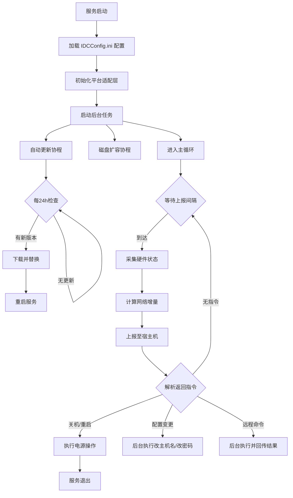

# CloudInit

OpenIDC 虚拟机初始化与状态上报服务。部署在虚拟机内部，负责定时采集硬件状态上报至宿主机，并接收宿主机下发的控制指令（关机/重启/改密/改主机名），同时支持磁盘自动扩容和服务自动更新。

服务使用 Go 编写，单一静态二进制，无需运行时依赖。

## 功能特性

- **状态上报** - 定时采集 CPU/内存/磁盘/GPU/网络 等硬件状态，上报至宿主机
- **主控探测** - 同一子网内先试缓存地址，再 32 并发探测其余地址（首个 `200 + 主控协议` 命中即停），全部失败才不上报；网关不再是 `.1` 结尾也可用
- **指令执行** - 接收宿主机下发的关机、重启、改密码、改主机名等控制指令
- **命令下发** - 接收宿主机下发的远程命令，异步执行并回传结果
- **VMware Tools 清理** - 非 VMware/ESXi 环境自动停止服务、结束进程并静默卸载（兼容 1063 等服务状态异常）
- **virtio 驱动安装** - Windows 下自动识别 KVM/QEMU 平台，发现 VirtIO 设备缺少驱动时自动下载并静默安装 virtio-win 驱动包
- **磁盘扩容** - 启动时自动检测并扩容根分区（支持 ext4/xfs/btrfs/APFS/NTFS）
- **自动更新** - 后台守护协程每24小时检查更新，优先走 EdgeOne 镜像，失败回退 GitHub
- **工具更新** - `tool` 目录下的工具按各自版本独立在线更新（含 sha256 校验）
- **远程桌面集成** - Windows 下自动启动 ToDesk / AnyDesk / 向日葵，主窗口只隐藏不关闭，并采集地址与密码随状态上报（ToDesk 额外强制关闭自动更新）
- **多平台支持** - 通过平台抽象层适配 Linux / Windows / macOS
- **配置覆盖** - 支持 `IDCConfig.ini` 文件覆盖默认运行参数

## 一键安装

脚本会自动下载最新版本、停止旧服务、替换二进制并注册开机自启服务（服务名统一为 `cloudinit`）。

**Linux / macOS**（root）：

```bash
curl -fsSL https://eo-idc.pika.net.cn/cloudinit/install.sh | sudo sh
```

指定版本：

```bash
curl -fsSL https://eo-idc.pika.net.cn/cloudinit/install.sh | sudo sh -s v0.4.6
```

**Windows**（管理员 PowerShell）：

```powershell
powershell -NoProfile -ExecutionPolicy Bypass -Command "irm https://eo-idc.pika.net.cn/cloudinit/install.ps1 | iex"
```

镜像不可用时改用 GitHub：

```bash
curl -fsSL https://github.com/OpenIDCSTeam/CloudInit/releases/latest/download/install.sh | sudo sh
```

```powershell
powershell -NoProfile -ExecutionPolicy Bypass -Command "irm https://github.com/OpenIDCSTeam/CloudInit/releases/latest/download/install.ps1 | iex"
```

| 平台 | 安装目录 | 服务 | 开机启动 |
|---|---|---|---|
| Windows | `C:\cloudinit` | Windows 服务 `cloudinit` | 自动（`sc query cloudinit` 可查） |
| Linux | `/opt/cloudinit` | systemd `cloudinit` | `systemctl enable` |
| macOS | `/opt/cloudinit` | launchd `cloudinit` | `RunAtLoad` |

- 重复执行即为升级：先停服务、替换二进制，`IDCConfig.ini`、`.version`、`tool/` 均保留。
- Windows 版二进制已内置服务支持（`svc.Run`），无需 NSSM 等第三方包装。
- 卸载：
  - Windows：`sc.exe stop cloudinit; sc.exe delete cloudinit`，再删除 `C:\cloudinit`
  - Linux：`systemctl disable --now cloudinit; rm -rf /opt/cloudinit /etc/systemd/system/cloudinit.service`
  - macOS：`sudo launchctl bootout system/cloudinit; rm -rf /opt/cloudinit /Library/LaunchDaemons/cloudinit.plist`

## 执行流程



## 项目结构

```
CloudInit/
├── main.go                  # 服务入口（主循环、上报、指令处理、信号）
├── go.mod / go.sum          # Go 模块依赖
├── IDCConfig.ini            # 运行配置文件（可选，覆盖默认参数）
│
├── tool/                    # 工具目录（脚本与客户端，支持在线更新）
│   ├── tools.json           # 工具版本清单（构建时生成发布资产）
│   └── MASAIO.cmd           # Windows 激活脚本
│
├── scripts/
│   └── sync_edgeone.sh      # EdgeOne 镜像站同步/部署脚本
│
├── apppath/                 # 运行目录 / 可执行文件路径
├── logger/                  # 日志（控制台 + 按天轮转文件）
├── config/                  # 配置加载器（解析 IDCConfig.ini）
│
├── core/                    # 核心管理模块
│   ├── manage.go            # 虚拟机配置管理（改主机名/改密码，非阻塞）
│   ├── disk.go              # 磁盘扩容（非阻塞）
│   ├── power.go             # 电源控制（关机/重启）
│   ├── cmdexecutor.go       # 远程命令执行与结果回传
│   └── autoupdate.go        # 自动更新（后台守护协程）
│
├── platform/                # 平台抽象层
│   ├── platform.go          # 接口定义 + hosts 处理 + 命令执行封装
│   ├── linux.go             # Linux 实现
│   ├── windows.go           # Windows 实现（含 VMTools 检测、系统激活）
│   └── darwin.go            # macOS 实现
│
├── nic/                     # 网卡管理模块
│   ├── ncmanage.go          # 网卡扫描与管理
│   ├── ncconfig.go          # 网卡配置数据模型
│   └── gateway_*.go         # 各平台默认网关探测
│
├── status/                  # 状态采集模块
│   ├── vmstatus.go          # 硬件状态采集器
│   ├── hwstatus.go          # 硬件状态数据模型
│   ├── vmpowers.go          # 电源状态枚举
│   └── gpu.go               # GPU 负载采集（nvidia-smi）
│
├── remotedesk/              # 远程桌面管理（ToDesk / AnyDesk / 向日葵）
│   ├── manager.go           # 启动客户端、定时采集地址与密码
│   ├── window_*.go          # 主窗口隐藏（Windows，仅隐藏不关闭）
│   └── config_windows.go    # 关闭 ToDesk 自动更新（config.ini isUpdate=0）
│
├── rdpdump/                 # 远程桌面凭据采集（原 PasswdDump，已内置）
│   ├── todesk_windows.go    # ToDesk 设备代码/临时密码
│   ├── anydesk_windows.go   # AnyDesk 地址/密码
│   └── sunlogin_windows.go  # 向日葵识别码/验证码

├── ServerInit/              # Linux 部署相关
│   ├── ServerInit.sh        # 一键部署脚本
│   └── ServerInit.service   # systemd 服务单元文件
│
└── .github/workflows/       # CI/CD
    ├── build.yml            # 构建 + 发布工作流
    └── build-passwddump.yml # PasswdDump 构建工作流
```

## 使用方式

### 编译

```bash
# 当前平台
go build -o CloudInit .

# 交叉编译示例
CGO_ENABLED=0 GOOS=linux   GOARCH=amd64 go build -o CloudInit-linux-x64 .
CGO_ENABLED=0 GOOS=windows GOARCH=amd64 go build -o CloudInit-win10-x64.exe .
```

> Windows 7/8.1 需使用 Go 1.20 及以下版本编译，Go 1.21+ 不再支持旧版 Windows。
>
> **发布资产文件名不可变更**（`CloudInit-win78-x64.exe`、`CloudInit-win10-x64.exe`、`CloudInit-linux-x64` 等）：
> 存量客户端的自动更新按文件名中的“系统标识 + 架构”匹配资产，改名会导致老版本无法升级。

### Linux 部署

```bash
# 1. 将 ServerInit 目录上传至目标虚拟机（将编译产物命名为 ServerInit）
# 2. 执行部署脚本（自动安装为 systemd 服务）
cd ServerInit
chmod +x ServerInit.sh
./ServerInit.sh
```

部署后服务自动启动，开机自启。管理命令：

```bash
systemctl status ServerInit   # 查看状态
systemctl restart ServerInit  # 重启服务
systemctl stop ServerInit     # 停止服务
journalctl -u ServerInit -f   # 查看日志
```

### Windows 部署

将编译后的 `CloudInit.exe` 放置到目标目录，工具统一放在同级的 `tool` 目录：

```
C:\CloudInit\
├── CloudInit.exe
├── IDCConfig.ini        # 可选
├── .version             # 运行时生成，记录当前版本
└── tool\
    ├── MASAIO.cmd
    ├── ToDesk.exe      # 可选
    ├── AnyDesk.exe     # 可选
    └── Sunlogin.exe    # 可选（向日葵）
```

老版本把工具直接放在程序根目录的，启动时会自动迁移到 `tool`（`.version` 保持在程序目录不动）。注册为 Windows 服务或通过计划任务启动。

### 开发环境运行

```bash
go run .
```

## 配置说明

创建 `IDCConfig.ini` 文件（与可执行文件同目录），可覆盖以下参数：

```ini
[server]
report_interval = 60          # 上报间隔（秒）
report_port = 1880            # 上报端口
report_path = /api/client/upload
report_host =                 # 固定上报地址（留空则自动推算）
gateway_offset = 2            # 上报地址扫描起点（子网内依次尝试 .2~.254；0/1 表示从网关开始）

[update]
enabled = true                # 是否启用自动更新
interval = 86400              # 检查间隔（秒）
repo_url = https://api.github.com/repos/OpenIDCSTeam/CloudInit/releases/latest
mirror_url = https://eo-idc.pika.net.cn/cloudinit   # EdgeOne 镜像（优先，留空则只走 GitHub）

[system]
virtio_enabled = true         # 自动检测 KVM 平台并安装 virtio 驱动
virtio_url_x64 = https://fedorapeople.org/groups/virt/virtio-win/direct-downloads/archive-virtio/virtio-win-0.1.302-1/virtio-win-gt-x64.msi
virtio_url_x86 = https://fedorapeople.org/groups/virt/virtio-win/direct-downloads/archive-virtio/virtio-win-0.1.302-1/virtio-win-gt-x86.msi

[log]
level = INFO                  # 日志级别
retention = 7 days            # 日志保留时间
```

## virtio 驱动自动安装

Windows 虚拟机启动后异步执行，不影响主循环与上报：

1. 读取 `HKLM\HARDWARE\DESCRIPTION\System\BIOS`，`SystemManufacturer` / `SystemProductName` / `BIOSVendor` 等字段命中 `QEMU`、`KVM`、`Red Hat`、`oVirt`、`Bochs` 时判定为 KVM 平台；VMware、Hyper-V、VirtualBox 不匹配，直接跳过。
2. 通过卸载注册表项判断是否已安装 virtio 驱动包（`DisplayName` 含 `VirtIO`），已安装则跳过。
3. 查询 PnP 设备中的 `VEN_1AF4`（Red Hat VirtIO）：没有该设备说明未使用 virtio，跳过；设备 `ConfigManagerErrorCode != 0` 或状态非 `OK` 说明缺驱动，才进入安装流程。
4. 按架构下载 `virtio-win-gt-x64.msi` / `virtio-win-gt-x86.msi`（arm64 暂不支持），缓存到 `tool/virtio-win-gt-<arch>.msi`，重复启动直接复用。
5. `msiexec /i ... /qn /norestart` 静默安装，返回 `0`/`3010`/`1638` 视为成功；失败后 6 小时内不再重试，避免每次启动重复下载。
6. 安装完成后部分设备需重启生效。

> 若虚拟机使用 virtio 网卡且完全没有网络，需先把驱动包放到 `tool/` 或改 `virtio_url_*` 指向内网镜像（本地已存在且大于 1MB 时会直接复用，不再下载）。

## 工具目录与工具更新

- 工具统一放在程序目录下的 `tool/`，程序启动时会把老版本放在根目录的 `MASAIO.cmd`、`ToDesk.exe`、`AnyDesk.exe` 自动迁移进去；`.version` 始终保留在程序目录。
- 工具版本记录在 `tool/tools.json`（`name` / `version` / `file`）。构建时会为每个工具生成带版本号的资产：`CloudInit-tool-<名称>-<版本><扩展名>`，并生成清单 `CloudInit-tools.json`（含 sha256）。
- 客户端每次检查更新时，按工具自身版本号与本地 `tool/.tool_versions.json` 比较，只下载更新的工具，并校验 sha256。
- **升级工具**：替换 `tool/` 下的文件并把 `tools.json` 里的 `version` 加一，提交后发版即可，存量机器会自动拉取。

## EdgeOne 镜像同步

正式版本发布会自动把构建产物同步到 `https://eo-idc.pika.net.cn/cloudinit`（`latest.json` + 全部资产 + 工具资产），客户端优先从该镜像更新，失败自动回退 GitHub。

需要配置：

| 类型 | 名称 | 说明 |
|---|---|---|
| Secret | `EDGEONE_API_TOKEN` | EdgeOne API Token（CI 部署用） |
| Variable | `EDGEONE_PROJECT_NAME` | EdgeOne Pages 项目名，默认 `cloudinit` |
| Variable | `EDGEONE_PREFIX` | 站点子路径，默认 `cloudinit`（即 `/cloudinit/latest.json`） |

本地生成镜像目录（不部署）：

```bash
./scripts/sync_edgeone.sh dist v0.4.1 eo-site
```

设置 `EDGEONE_API_TOKEN` 后脚本会调用 `edgeone pages deploy eo-site -n <项目> -e production` 完成部署。

## 日志

- 控制台：`时间 | 级别 | 消息`，级别由 `[log] level` 控制
- 文件：`logs/cloudinit_YYYY-MM-DD.log`，固定 DEBUG 级别，按天轮转，按保留期清理

## 许可证

GPL-3.0 License
